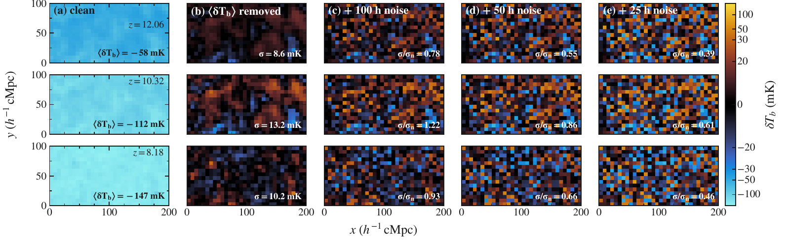
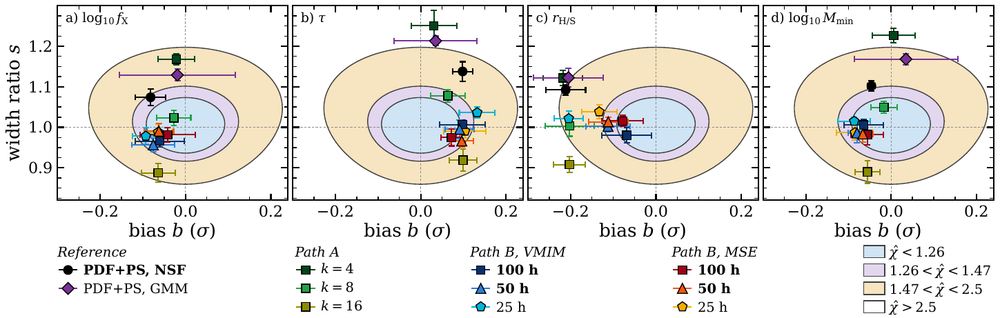
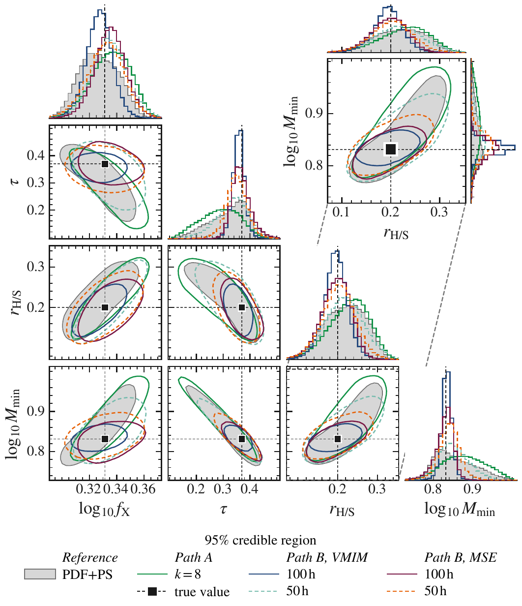

<p align="center">
  
</p>

<p align="center">
  = 3.10">
  = 2.0">
  
  
  
</p>

<p align="center">
  <a href="#key-results"><b>Results</b></a> ·
  <a href="#install"><b>Install</b></a> ·
  <a href="#quick-start"><b>Quick start</b></a> ·
  <a href="#the-pipeline"><b>Pipeline</b></a> ·
  <a href="#data-format"><b>Data</b></a> ·
  <a href="#the-cnn-compressor-as-a-module"><b>CNN module</b></a>
</p>

---

**vmim21cm** compresses 21-cm data into a few numbers that keep as much information about the
astrophysical parameters as possible, then does simulation-based inference with them.

The 21-cm signal from the Epoch of Reionisation is usually analysed through hand-crafted
statistics: the power spectrum (PS) and, more recently, its combination with the L-moments of the
pixel distribution function (PDF+PS). These capture only part of the non-Gaussian structure of the
field. This code tests whether **a 3D convolutional network trained to maximise the mutual
information between its summary and the parameters (VMIM)** extracts more information from
SKA-like noisy observations than PDF+PS, **without degrading the calibration of the posterior**.

| | input | compressor | objective |
|---|---|---|---|
| **PDF+PS reference** | 30 hand-crafted summaries (15 PDF + 15 PS) | none | |
| **Path A** | the same 30 summaries | MLP to `t_dim` = 4, 8, 16 | VMIM or MSE |
| **Path B** | mean-removed noisy coeval cubes, 3 redshifts | 3D residual CNN to `t_dim` = 4, 8 | VMIM or MSE |

Every summary `t` then goes through the same steps: a neural likelihood `q(t | theta)`, MCMC
posteriors for a fixed set of simulation-based-calibration (SBC) targets, and calibration and
constraining-power metrics.

## Key results

<p align="center"></p>
<p align="center"></p>
<p align="center"></p>

## Install

```bash
git clone <this repository> vmim21cm && cd vmim21cm
pip install -e ".[dev]"          # or: pip install -r requirements.txt  (exact paper versions)
```

Python >= 3.10 and PyTorch >= 2.0. Runs on CPU, CUDA GPUs and Apple-silicon (MPS) GPUs; stage 1
picks the device automatically (`--device auto|cpu|cuda|mps`).

## Quick start

A complete run on tiny synthetic data, on a laptop, in a few minutes:

```bash
vmim21cm demo demo/                          # synthetic data + three configs in demo/
vmim21cm run demo/baseline.yaml --eval       # PDF+PS-like baseline: stages 2-4
vmim21cm run demo/patha.yaml --eval          # Path A: MLP + VMIM, stages 1-4
vmim21cm run demo/pathb.yaml --eval          # Path B: 3D CNN + MSE, stages 1-4
vmim21cm stage4 demo/eval.yaml               # compare the three
```

With your own data, point the configs at it, either through environment variables or on the
command line:

```bash
export SBI_SUMMARIES=/data/pdf_ps.npz SBI_SBC_TARGETS=/data/targets.npy SBI_OUT=$PWD/runs
vmim21cm run configs/patha/vmim_k8.yaml --cseeds 43 --nseeds 42 --eval
vmim21cm run configs/patha/vmim_k8.yaml --set nle.n_layers=4 --set out_root=/scratch/runs
```

`vmim21cm run` runs stages 1-3 for every (compressor seed, NLE seed) pair of a config on the
current machine; `--stages 2,3` restarts later stages, `--dry-run` prints the commands.

## The pipeline

A run is one config plus a compressor seed `--cseed` and an NLE seed `--nseed`. Each config lists
its seeds (the paper uses compressor seeds 43, 44, 45 and NLE seeds 42, 43, 44).

| command | what it does |
|---|---|
| `vmim21cm stage1 CONFIG --cseed C` | trains the compressor (400 epochs, final weights kept) and exports `t` for every row of the training table. For Path B the table is every simulation times `n_noise` deterministic noise draws; the export can be split over the noise axis (`--shard k --nshard n`, then `vmim21cm merge`). Not needed for the baseline. |
| `vmim21cm stage2 CONFIG --cseed C --nseed N` | trains a neural spline flow `q(t \| theta)` on standardised `t` (CPU). |
| `vmim21cm stage3 CONFIG --cseed C --nseed N` | 160 walkers x 2000 steps (500 burn-in) per SBC target. All targets step together in chunks of `--batch-targets` (default 320), one likelihood call per half-move; the chains are the same as one-by-one sampling (`--no-batched`) and ~10x cheaper. A 908-target run takes 20-30 min on 4 CPUs. `--task k --ntasks n` splits the targets over jobs. |
| `vmim21cm stage4 EVAL` | SBC rank histograms, calibration ratio (1 = ranks consistent with uniform) and posterior volume `GV = median sqrt(det Cov)` on the simulations shared by all runs, after a stuck-walker cut, thinning by 11 and a 10-nat log-posterior cut. |

Outputs go to `{out_root}/{name}/c{cseed}/` (`compressor/`, `summaries/`, `nle_n{nseed}/`,
`chains_n{nseed}/`); the baseline writes to `{out_root}/{name}/raw/`. Any config value can be
overridden with `--set key.subkey=value`.

### Configs

`configs/` holds the paper setup, one YAML per experiment:

* `baseline/pdf_ps.yaml`: NLE on the 30 PDF+PS summaries (NSF 8 layers x 64 hidden)
* `patha/vmim_k{4,8,16}.yaml`, `patha/mse_k4.yaml`: MLP compressor (NSF 8 x 64)
* `pathb/{vmim_k4,vmim_k8,mse_k4}_{100,50,25}h.yaml`: CNN compressor at three noise levels (NSF 8 x 128)
* `eval/paper.yaml`: the stage-4 grouping of the paper table (Path B 100 h with compressor seeds 43, 44)

### On a SLURM cluster

```bash
cp slurm/env.example.sh slurm/env.sh         # data/output paths, environment activation, node exclusions
bash slurm/submit.sh configs/patha/vmim_k8.yaml                    # every seed, as a dependency chain
CSEEDS=43 NSEEDS=42 bash slurm/submit.sh configs/pathb/vmim_k8_100h.yaml
sbatch slurm/stage4.sbatch configs/eval/paper.yaml
```

Run these from the repository root. The sbatch scripts put `src/` on `PYTHONPATH`, so the package
does not need to be installed in the cluster environment. Edit partitions, times and GPU requests
in the `#SBATCH` headers for your site.

## Data format

Configs refer to data through environment variables (`${SBI_DATA}`, `${SBI_SUMMARIES}`,
`${SBI_SBC_TARGETS}`, `${SBI_OUT}`), or take paths directly.

* **Summary table** (`.npz`): `theta` (rows, n_params), already mapped to [0, 1];
  `t` (rows, n_summaries); `original_sim_ids` (rows,). Each simulation has several rows, one per
  noise realisation.
* **Cubes** (Path B): one raw float64 file per redshift channel for the signal (row = simulation)
  and one for a pool of noise cubes, each of shape `box^3`. `params_path` holds the physical
  parameters, row-aligned with `sim_ids_path` (row of each simulation in the signal files).
  `data.params` maps each parameter to [0, 1]:
  * `{transform: none}`: already in [0, 1]
  * `{transform: linear, lo, hi[, scale]}`: `(p/scale - lo) / (hi - lo)`
  * `{transform: log10, lo, hi[, scale]}` or `{transform: log10, log_lo, log_hi[, scale]}`: the same in log10
* **SBC targets** (`.npy`, pickled list of dicts): `{'sim': id, 'offset': k}` selects row k of
  simulation `id` in the summary table.

`vmim21cm demo DIR` writes a small example of every file.

### Other simulators

Nothing past stage 1 knows about 21 cm: stages 2-4 only read `theta`, `t` and the sim ids.

* **Hand-crafted summaries** from another simulator (21cmFAST, CAMELS 3D grids, ...) run through
  Path A once written in the summary-table format.
* **Fields** need signal and noise cubes in the format above; for noise-free data, use a noise
  file of zeros. The number of channels is read from `signal_paths`.
* **Check per simulator**: the parameter map (`data.params`), `n_params`, and
  `mcmc.use_wedge_prior` (the `(tau, Mmin)` wedge is specific to the 21-cm parameter set).

## The CNN compressor as a module

A trained Path B compressor can be used on its own, outside the pipeline:

```python
import numpy as np
from vmim21cm.cnn import CubeCompressor

cc = CubeCompressor.from_run("runs/pathb/vmim_k8_100h/c43", device="cpu")
cubes = np.fromfile(...).reshape(n, 3, 32, 32, 32)   # observed signal + noise, (N, channels, box, box, box)
t = cc.compress(cubes)                                # (N, t_dim) summaries
```

`compress` applies the same preprocessing as training (per-cube mean removal, per-channel
standardisation saved by stage 1 in `compressor/cube_stats.npz`). For weights without that file,
use `CubeCompressor.from_checkpoint(weights, means, stds)`. The network itself is
`vmim21cm.compressors.CNNCompressor`. A checkpoint only applies to data prepared like its
training set (box size, redshifts, noise level).

## Tests

```bash
pytest -m "not slow"     # unit tests, seconds
pytest -m slow           # end-to-end pipeline on synthetic data, a few minutes on CPU
```

The end-to-end test checks the training losses against values from the original research code
(`tests/data/reference_synthetic.json`). GitHub Actions runs both on every push.

## Reproducibility

Under the same seeds and software versions (`requirements.txt`), the code reproduces the original
research code: the same network initialisation and forward passes, identical CPU training
trajectories, and the same chains. GPU training (Path B) uses `cudnn.benchmark` and is not
bitwise reproducible. `configs/eval/example_chains.yaml` compares a rerun with earlier chains.

## Layout

```
src/vmim21cm/
  config.py       YAML loading, ${VAR} expansion, --set overrides, run directories, seeding, devices
  data.py         summary tables, simulation-level train/val split, SBC targets
  cubes.py        cube dataset: signal + scaled noise, mean removal, standardisation, augmentation, export
  compressors.py  MLP, 3D CNN, Gaussian-mixture head q(theta | t)
  cnn.py          CubeCompressor: trained CNN + preprocessing, compress(cubes) -> t
  train.py        compressor training loop (VMIM / MSE)
  nle.py          neural spline flow likelihood q(t | theta)
  mcmc.py         stretch-move ensemble sampler with the (tau, Mmin) wedge prior, batched over targets
  evaluate.py     SBC ranks, calibration ratio, posterior volume
  synthetic.py    tiny synthetic dataset + configs
  stages/         stage1, merge, stage2, stage3, stage4, pipeline (vmim21cm run)
  cli.py          the vmim21cm command
configs/          paper experiments and stage-4 groupings
slurm/            one sbatch script per stage, submit.sh, env.example.sh
tests/            pytest suite
```

---

<p align="center"><sub>LUX · Observatoire de Paris · Université PSL</sub></p>
