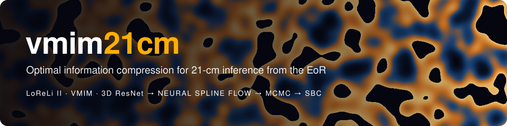

  

  = 3.10">
  = 2.0">
  
  
  

  <a href="#key-results"><b>Results</b></a> ·
  <a href="#install"><b>Install</b></a> ·
  <a href="#quick-start"><b>Quick start</b></a> ·
  <a href="#the-pipeline"><b>Pipeline</b></a> ·
  <a href="#data-format"><b>Data</b></a> ·
  <a href="#the-cnn-compressor-as-a-module"><b>CNN module</b></a>

---

**vmim21cm** compresses 21-cm data into a few numbers that keep as much information about the
astrophysical parameters as possible, then does simulation-based inference with them.

The 21-cm signal from the Epoch of Reionisation is usually analysed through hand-crafted
statistics: the power spectrum (PS) and, more recently, its combination with the L-moments of the
pixel distribution function (PDF+PS). These capture only part of the non-Gaussian structure of the
field. This code tests whether **a 3D convolutional network trained to maximise the mutual
information between its summary and the parameters (VMIM)** extracts more information from
SKA-like noisy observations than PDF+PS, **without degrading the calibration of the posterior**.

